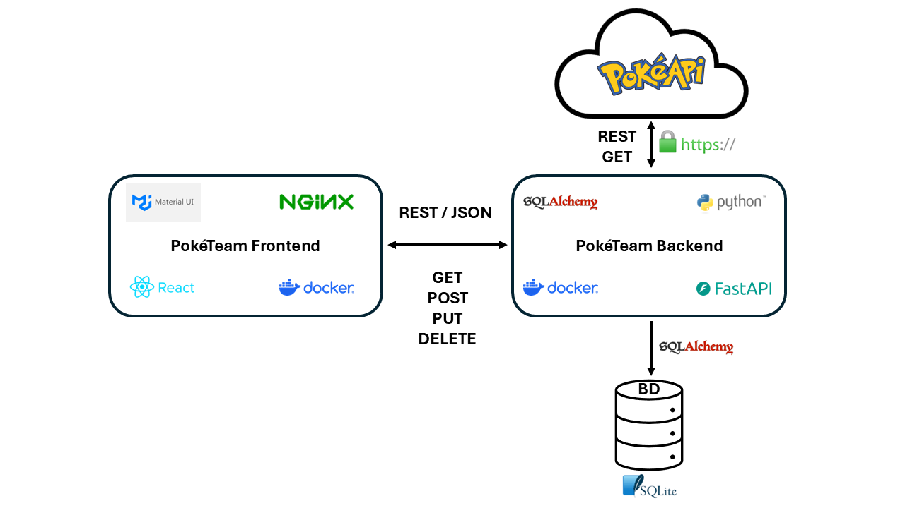

# PokéTeam

Interface web para pesquisa de Pokémon e gerenciamento de uma equipe personalizada com até seis integrantes.

O **PokéTeam** foi desenvolvido como MVP da disciplina de Arquitetura de Software. A solução utiliza uma arquitetura baseada em componentes independentes, composta por um frontend React, uma API REST própria desenvolvida em FastAPI e a API externa PokéAPI.

## Objetivo

O objetivo da aplicação é permitir que o usuário:

- pesquise Pokémon pelo nome ou número da Pokédex;
- visualize informações e atributos do Pokémon;
- monte uma equipe com até seis integrantes;
- edite informações personalizadas dos membros da equipe;
- remova Pokémon da equipe.

O frontend não acessa diretamente a API externa.

Toda comunicação com a PokéAPI é intermediada pela **PokéTeam API**, responsável pelas regras de negócio, persistência e tratamento dos dados externos.

---

## Funcionalidades

- Pesquisa de Pokémon por nome.
- Pesquisa de Pokémon pelo número da Pokédex.
- Exibição da arte oficial do Pokémon.
- Exibição dos tipos do Pokémon.
- Exibição de HP, ataque, defesa e velocidade.
- Exibição de altura e peso.
- Inclusão de Pokémon na equipe.
- Limite de seis Pokémon por equipe.
- Validação de Pokémon duplicados.
- Listagem dos integrantes da equipe.
- Edição de apelido.
- Edição da função do Pokémon na equipe.
- Edição de observações.
- Remoção de Pokémon.
- Feedback visual de sucesso e erro.
- Interface responsiva para diferentes tamanhos de tela.

---

## Tecnologias utilizadas

### Frontend

- React
- JavaScript
- Vite
- Material UI
- Fetch API
- Oxlint

### Execução em container

- Docker
- Nginx

### Comunicação

- REST
- JSON
- HTTP

---

## Arquitetura da solução

A solução é composta por três componentes principais:

1. **PokéTeam Frontend**
2. **PokéTeam API**
3. **PokéAPI**

Além disso, o backend utiliza SQLite para persistência dos dados da equipe.

```text
                              ┌─────────────────┐
                              │     PokéAPI     │
                              │   API externa   │
                              │   REST / GET    │
                              └────────▲────────┘
                                       │
                                       │ HTTP
                                       │
┌──────────────────┐       REST       ┌┴─────────────────┐
│                  │─────────────────►│                  │
│     FRONTEND     │                  │     BACKEND      │
│                  │◄─────────────────│                  │
│ React + MUI      │                  │ FastAPI + Python │
│ Nginx + Docker   │                  │ Docker           │
└──────────────────┘                  └────────┬─────────┘
                                              │
                                              │ SQLAlchemy
                                              ▼
                                     ┌─────────────────┐
                                     │     SQLite      │
                                     │  Persistência   │
                                     └─────────────────┘
```

O fluxo de comunicação principal é:

```text
Usuário
   |
   v
PokéTeam Frontend
   |
   | REST
   v
PokéTeam API
   |
   +-----------> PokéAPI
   |
   +-----------> SQLite
```


```markdown
### Diagrama da arquitetura


```

---

## Responsabilidades dos componentes

### PokéTeam Frontend

Responsável por:

- interação com o usuário;
- pesquisa de Pokémon;
- apresentação dos dados;
- envio de comandos para o backend;
- gerenciamento visual da equipe;
- mensagens de sucesso e erro.

### PokéTeam API

Responsável por:

- regras de negócio;
- validação das operações;
- persistência dos dados;
- integração com a PokéAPI;
- tratamento dos dados externos;
- disponibilização da API REST para o frontend.

### PokéAPI

Responsável por fornecer os dados oficiais utilizados pela aplicação, como:

- identificador do Pokémon;
- nome;
- tipos;
- atributos;
- altura;
- peso;
- imagens.

### SQLite

Responsável pela persistência local dos integrantes da equipe.

---

## Comunicação entre frontend e backend

O frontend utiliza uma API REST desenvolvida especificamente para o projeto.

Os quatro principais métodos HTTP são utilizados:

| Método | Finalidade |
|---|---|
| `GET` | Consultar Pokémon e carregar a equipe |
| `POST` | Adicionar Pokémon à equipe |
| `PUT` | Editar informações de um Pokémon |
| `DELETE` | Remover Pokémon da equipe |

### Rotas consumidas pelo frontend

#### Pesquisar Pokémon

```http
GET /api/v1/pokemon/{name_or_id}
```

Exemplos:

```text
/api/v1/pokemon/pikachu
/api/v1/pokemon/25
```

#### Listar equipe

```http
GET /api/v1/team
```

#### Adicionar Pokémon

```http
POST /api/v1/team
```

#### Editar Pokémon

```http
PUT /api/v1/team/{id}
```

#### Remover Pokémon

```http
DELETE /api/v1/team/{id}
```

---

## API externa

A solução utiliza a **PokéAPI v2** como serviço externo.

A PokéAPI disponibiliza informações sobre Pokémon por meio de uma API REST.

O frontend **não realiza chamadas diretamente à PokéAPI**.

A comunicação ocorre da seguinte maneira:

```text
Frontend
   |
   v
PokéTeam API
   |
   v
PokéAPI
```

Endpoint externo utilizado pelo backend:

```http
GET https://pokeapi.co/api/v2/pokemon/{id-ou-nome}
```

O backend recebe a resposta da PokéAPI, seleciona os campos utilizados pelo projeto e entrega ao frontend um contrato de dados simplificado.

Exemplo:

```json
{
  "id": 25,
  "name": "pikachu",
  "image_url": "https://...",
  "types": [
    "electric"
  ],
  "height": 4,
  "weight": 60,
  "stats": {
    "hp": 35,
    "attack": 55,
    "defense": 40,
    "speed": 90
  }
}
```

Essa abordagem reduz o acoplamento entre a interface e a API externa.

---

## Estrutura do projeto

```text
poketeam-frontend/
│
├── public/
│
├── src/
│   ├── api/
│   │   └── apiClient.js
│   │
│   ├── components/
│   │   ├── PokemonCard.jsx
│   │   ├── PokemonSearch.jsx
│   │   ├── TeamCard.jsx
│   │   └── TeamEditor.jsx
│   │
│   ├── pages/
│   │   └── HomePage.jsx
│   │
│   ├── theme/
│   │   └── theme.js
│   │
│   ├── App.jsx
│   ├── index.css
│   └── main.jsx
│
├── .dockerignore
├── .gitignore
├── Dockerfile
├── package.json
├── package-lock.json
├── README.md
└── vite.config.js
```

---

## Organização do frontend

### `src/api`

Contém o cliente responsável pela comunicação HTTP com o backend.

O arquivo:

```text
src/api/apiClient.js
```

centraliza as operações:

```text
getPokemon()
getTeam()
addPokemonToTeam()
updateTeamPokemon()
removePokemonFromTeam()
```

Dessa forma, os componentes da interface não precisam conhecer diretamente as URLs das rotas.

---

### `src/components`

Contém componentes reutilizáveis da interface.

#### `PokemonSearch`

Responsável pela entrada utilizada para pesquisar Pokémon.

#### `PokemonCard`

Apresenta os dados do Pokémon pesquisado e permite adicioná-lo à equipe.

#### `TeamCard`

Representa visualmente um Pokémon pertencente à equipe.

#### `TeamEditor`

Disponibiliza o formulário para edição das informações personalizadas.

---

### `src/pages`

Contém as páginas da aplicação.

A página principal é:

```text
HomePage.jsx
```

Ela coordena:

- pesquisa;
- carregamento da equipe;
- inclusão;
- edição;
- remoção;
- notificações;
- estado da interface.

---

### `src/theme`

Contém as configurações visuais utilizadas pelo Material UI.

---

## Pré-requisitos

Para execução local:

- Node.js 22
- npm

Para execução em container:

- Docker

O backend PokéTeam API também precisa estar em execução para que todas as funcionalidades estejam disponíveis.

---

## Execução local

Entre no diretório do projeto:

```bash
cd poketeam-frontend
```

Instale as dependências:

```bash
npm install
```

Execute o servidor de desenvolvimento:

```bash
npm run dev
```

A aplicação estará disponível em:

```text
http://localhost:5173
```

Durante a execução local, o backend deve estar disponível em:

```text
http://localhost:8000
```

---

## Validação do código

O projeto utiliza **Oxlint** para análise estática.

Execute:

```bash
npm run lint
```

Resultado esperado:

```text
Found 0 warnings and 0 errors.
```

---

## Build de produção

Para gerar uma versão de produção:

```bash
npm run build
```

Os arquivos gerados serão armazenados no diretório:

```text
dist/
```

---

## Execução com Docker

O frontend utiliza um Dockerfile com build em múltiplas etapas.

Na primeira etapa:

- Node.js instala as dependências;
- Vite gera o build de produção.

Na segunda etapa:

- Nginx serve os arquivos estáticos gerados.

### Construir a imagem

Na raiz do projeto:

```bash
docker build -t poketeam-frontend .
```

### Executar o container

```bash
docker run --rm \
  --name poketeam-frontend \
  -p 3000:80 \
  poketeam-frontend
```

A aplicação estará disponível em:

```text
http://localhost:3000
```

---

## Execução completa da solução

Para utilizar a aplicação completa, o backend e o frontend devem estar em execução simultaneamente.

### Backend

```text
http://localhost:8000
```

Swagger:

```text
http://localhost:8000/docs
```

### Frontend em desenvolvimento

```text
http://localhost:5173
```

### Frontend em Docker

```text
http://localhost:3000
```

---

## Exemplo de fluxo de utilização

1. Acesse o PokéTeam.
2. Digite o nome ou número de um Pokémon.
3. Clique em **Buscar**.
4. Visualize:
   - imagem;
   - número da Pokédex;
   - tipos;
   - HP;
   - ataque;
   - defesa;
   - velocidade;
   - altura;
   - peso.
5. Clique em **Adicionar à equipe**.
6. O Pokémon será persistido pelo backend.
7. Clique em **Editar** para personalizar:
   - apelido;
   - função;
   - observações.
8. Clique em **Remover** caso queira retirar o Pokémon da equipe.

---

## Regras da equipe

A aplicação respeita as regras de negócio definidas no backend:

- máximo de seis Pokémon por equipe;
- não são permitidos Pokémon duplicados;
- somente Pokémon válidos podem ser adicionados;
- atributos oficiais são obtidos da PokéAPI;
- apelido, função e observações podem ser personalizados.

---

## Tratamento de erros

O frontend apresenta mensagens amigáveis quando ocorrem situações como:

- Pokémon inexistente;
- falha de comunicação com o backend;
- tentativa de adicionar Pokémon duplicado;
- equipe com seis integrantes;
- falha durante edição;
- falha durante remoção.

As mensagens retornadas pelo backend são apresentadas ao usuário por meio de notificações visuais.

---

## Decisões de arquitetura

### Frontend separado do backend

O frontend e o backend são componentes independentes e possuem ciclos de execução separados.

Isso permite que cada componente:

- tenha responsabilidades próprias;
- possa ser desenvolvido independentemente;
- possa ser executado em seu próprio container;
- possua seu próprio repositório.

### Backend como intermediário da API externa

A interface não depende diretamente do contrato da PokéAPI.

Em vez de:

```text
Frontend -> PokéAPI
```

a solução utiliza:

```text
Frontend -> PokéTeam API -> PokéAPI
```

Isso permite centralizar:

- regras de negócio;
- tratamento de erros;
- transformação de dados;
- integração externa;
- persistência.

### Cliente HTTP centralizado

As chamadas REST são centralizadas em:

```text
src/api/apiClient.js
```

Essa decisão evita a repetição de URLs e lógica HTTP pelos componentes React.

### Material UI

O Material UI foi utilizado para acelerar a construção de uma interface consistente, responsiva e reutilizável.

### Nginx no container

O servidor de desenvolvimento do Vite não é utilizado na imagem final.

O build React é servido pelo Nginx, separando adequadamente o ambiente de desenvolvimento da execução em container.

---

## Status do projeto

MVP funcional.

### Requisitos implementados

- [x] Interface web.
- [x] Componente frontend independente.
- [x] Comunicação com API REST própria.
- [x] Integração indireta com API externa.
- [x] Método GET.
- [x] Método POST.
- [x] Método PUT.
- [x] Método DELETE.
- [x] Persistência de dados.
- [x] Interface responsiva.
- [x] Tratamento de erros.
- [x] Dockerfile.
- [x] Execução com Docker.
- [x] Validação do código com linter.

---

## Melhorias futuras

Possíveis evoluções da aplicação, fora do escopo do MVP:

- autenticação de usuários;
- múltiplas equipes;
- comparação entre Pokémon;
- filtros por tipo;
- ordenação por atributos;
- estatísticas agregadas da equipe;
- análise de distribuição de tipos;
- testes automatizados de frontend;
- configuração do endereço da API por variável de ambiente;
- pipeline de CI/CD.

Essas funcionalidades não fazem parte do escopo atual do MVP.

---

## Finalidade acadêmica

Este projeto foi desenvolvido para fins acadêmicos como parte de uma atividade da disciplina de Arquitetura de Software.

Pokémon, seus personagens, nomes, imagens e demais propriedades relacionadas à franquia pertencem aos seus respectivos titulares.

A PokéAPI é utilizada somente como fonte pública de dados.